# Survival Top-down

Survival Top-down is a single-player action survival game built with Unity. The player fights through five increasingly difficult waves, combines a spread-shot basic attack with two active skills, and gains permanent combat upgrades during each run.

The project focuses on responsive mobile-first combat, readable gameplay feedback, data-driven balancing, and reusable gameplay systems.

## Gameplay loop

1. Move through the arena and keep distance from melee and ranged enemies.
2. Use the basic attack, bomb, and repulse dash to control each wave.
3. Defeat enemies to gain EXP and improve health, armor, and damage.
4. Survive all five waves to complete the run.

## Key features

### Player combat

- Mobile joystick, keyboard/mouse, and gamepad input through Unity Input System.
- Auto-targeting selects a valid enemy inside the `6.5` unit attack range.
- Movement keeps control of the player's facing direction; pressing attack instantly faces the target for the shot, then returns rotation control to movement.
- Aim-aligned projectile spawning prevents shots from crossing through the player model during fast direction changes.
- Three-projectile spread attack with fixed three-charge resource and timed charge recovery.
- Bomb skill with delayed area damage and a repulse dash that combines movement with an impact explosion.
- World-space range indicators are reused for the basic attack, bomb, and dash.

### Enemies and status effects

- Melee enemies chase with NavMesh and validate distance plus a `50` degree attack cone at the damage frame.
- Ranged enemies fire homing poison projectiles that can still be blocked by obstacles.
- Poison refreshes instead of stacking duplicate coroutines.
- Poison ticks display colored damage numbers, a ground aura, and a countdown status label above the player.
- Enemy animation states cover idle, movement, attack, death, and victory.

### Waves and progression

- Five ScriptableObject-driven waves with increasing enemy count and spawn pressure.
- Melee and ranged enemies provide different EXP rewards.
- Level-ups increase current health, maximum health, armor, and damage multiplier while preserving excess EXP.
- Victory, game-over, restart, wave progress, enemy count, level, and EXP interfaces complete the gameplay loop.

### Feedback and performance

- Camera shake, hit effects, skill VFX, damage popups, sound effects, and background music.
- Object pools for enemies, projectiles, VFX, and damage popups.
- `Physics.OverlapSphereNonAlloc` is used for repeated target queries.
- Combat and progression values are separated into ScriptableObjects for quick balancing.

## Architecture

Gameplay responsibilities are split into focused components such as movement, facing, targeting, weapons, skills, health, progression, enemy movement, and wave control. Event-driven UI components observe gameplay state without owning combat logic, while factories manage pooled runtime objects.

The full class diagram is available in [`Docs/Project-UML.svg`](Docs/Project-UML.svg), with Mermaid source in [`Docs/Project-UML.mmd`](Docs/Project-UML.mmd).

## Technology

| Technology | Version / use |
|---|---|
| Unity | `6000.3.10f1` |
| Universal Render Pipeline | `17.3.0` |
| Input System | `1.18.0` |
| Cinemachine | `3.1.7` |
| AI Navigation | `2.0.10` |
| Language | C# |
| Primary build target | Android |

## Controls

### Mobile / Unity Editor UI

| Control | Action |
|---|---|
| Left joystick | Move |
| Main attack button | Fire spread shot |
| Blast | Place bomb |
| Repulse | Dash and explode |
| Play Again | Restart after victory or game over |

### Keyboard and mouse

| Input | Action |
|---|---|
| `WASD` | Move |
| `Space` or left mouse button | Basic attack |
| `Q` | Blast |
| `E` | Repulse |

### Gamepad

| Input | Action |
|---|---|
| Left Stick | Move |
| Button South | Basic attack |
| Button West | Blast |
| Button North | Repulse |

## Project structure

| Path | Responsibility |
|---|---|
| `Assets/Scripts/Player` | Movement, facing, targeting, weapon, skills, progression |
| `Assets/Scripts/Enemy` | Enemy state, NavMesh movement, melee and ranged attacks |
| `Assets/Scripts/Combat` | Projectiles, poison, bombs, area damage, pooling |
| `Assets/Scripts/UI` | HUD, health, wave, status, result, damage popup |
| `Assets/Scripts/Data` | ScriptableObject definitions |
| `Assets/Data` | Tunable combat, enemy, progression, skill, and wave values |
| `Assets/Prefabs` | Player, enemies, projectiles, UI, VFX, and indicators |
| `Assets/Scenes/SampleScene.unity` | Main gameplay scene |

## Run the project

1. Clone the repository.
2. Add the project folder through Unity Hub using **Add project from disk**.
3. Open it with Unity `6000.3.10f1` and wait for package import and script compilation to finish.
4. Open `Assets/Scenes/SampleScene.unity`.
5. Enter Play Mode. The first wave begins automatically after a short delay.

`SampleScene` is already enabled in **Build Profiles > Scene List**.

## Build

1. Open **File > Build Profiles**.
2. Select Android and confirm `SampleScene` is enabled.
3. Wait until Unity finishes compiling and the Console contains no errors.
4. Choose **Build** and select an output location outside the `Assets` folder.

## Asset dependencies

Some raw Asset Store packages are not stored in this repository. If models, materials, or animations are missing, reimport the corresponding packages from **Window > Package Manager > My Assets**:

- Tiny Bird Duo PBR Polyart
- Elementary Dungeon Pack Lite
- Golem character and animation package used by the enemy prefabs

The repository includes the gameplay code, scenes, prefab configuration, custom materials, Input Actions, NavMesh data, Animator Controllers, and project-authored documentation.

## Current scope

- One arena and one complete five-wave run.
- Local single-player gameplay.
- Mobile-first UI with desktop and gamepad controls for development and testing.
